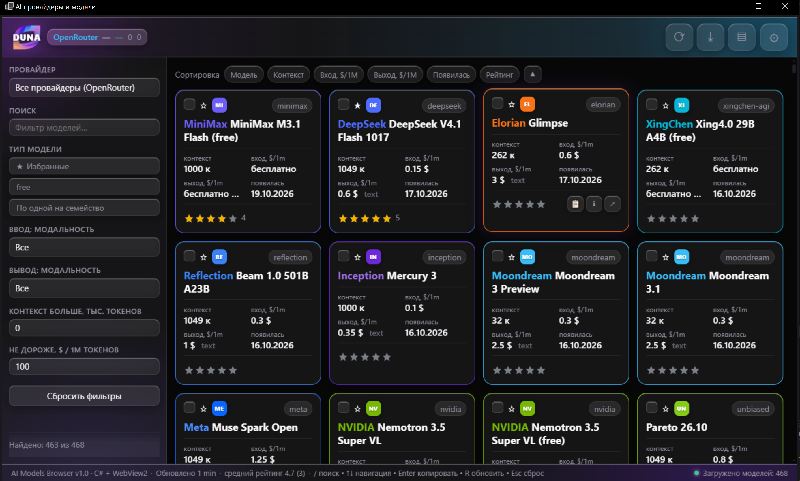
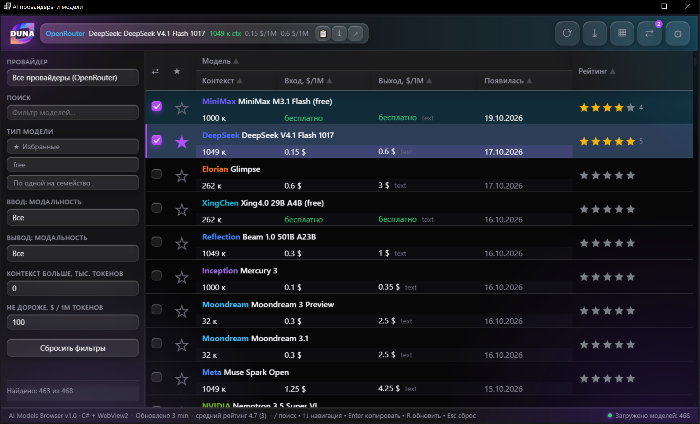
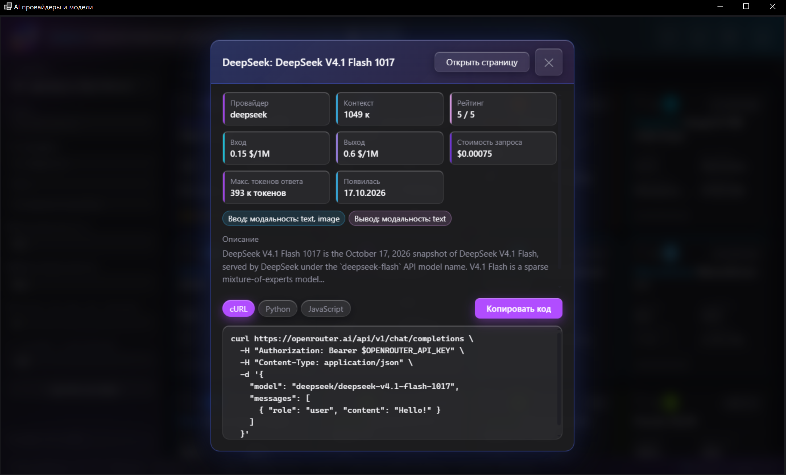
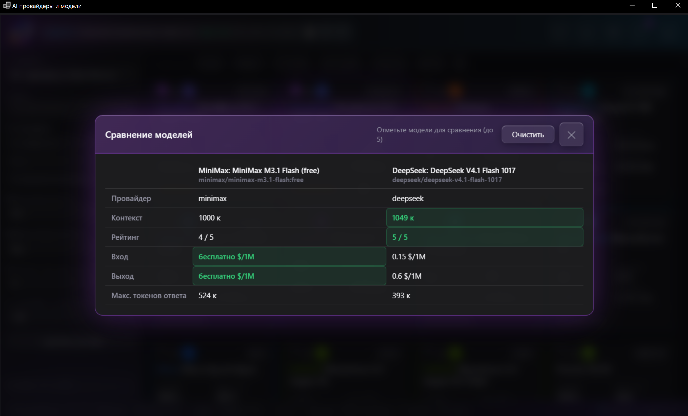
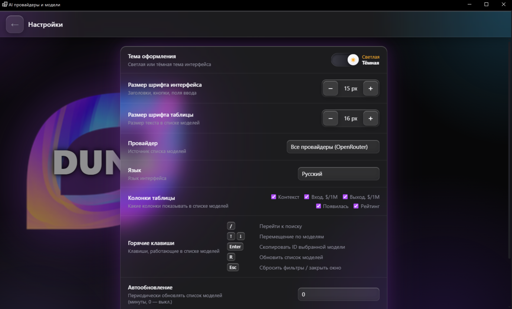

<div align="center">

# AI Models Browser

**A desktop browser for the OpenRouter AI model catalog.**

[](https://learn.microsoft.com/en-us/windows/apps/get-started/)
[](https://dotnet.microsoft.com/)
[](https://learn.microsoft.com/en-us/microsoft-edge/webview2/)
[](LICENSE)
[](wwwroot/i18n.js)

Find the right model, compare it with the alternatives, take the code with you.
No sign-up, no API key, liquid-glass interface.

> Русская версия этого README: [README.ru.md](README.ru.md)

</div>

---

## 📸 Screenshots

**Cards — four models per row.** Every model gets its own color: the frame and the badge come from
the brand color of the company that makes it.



**Table.** The same thing as a list, sortable by any column.



**Model card.** All the specs, the cost of a single request, and a ready-to-run snippet for cURL,
Python or JavaScript — all in one window.



**Comparison.** Tick up to five models and see who is cheaper, who has more context, and where your
own rating is highest.



**Settings.** Theme, fonts, language, columns, keyboard shortcuts.



---

## 💡 What it does

### Find the right model

There are around 470 models in the OpenRouter catalog, and picking one without filters is
pointless. Here everything to narrow it down is right there:

- **Search** by name and id, with matches highlighted right in the list.
- **Filter by provider**, if you want one specific company rather than the whole lot.
- **Favorites only** — the models you starred, in one click.
- **Free only** — the models that cost nothing.
- **One model per family** — when a family ships ten variations of the same thing, only the
  cheapest one is left.
- **Modalities** — separately for what a model accepts and what it returns: text, images, audio.
- **Context and price limits** — set a minimum window and a maximum price per million tokens, and
  get only the models that fit.

The filters combine instead of replacing each other, so you can ask for "nothing above $2, text
input only, at least 100k context" in one go.

### Compare the options

Tick models with the `⇄` checkbox (up to five) and open the comparison window. The best value in
every column is highlighted, so it is immediately obvious who has more context, who is cheaper and
where your own rating is highest.

### Work out what a request will cost

Every model gets a price calculated for a standard request of 1000 input and 1000 output tokens.
That is easier to reason about than "$0.15 per million" when you are trying to estimate a bill.

### Take the code with you

The model card includes a ready-to-run request in **cURL**, **Python** or **JavaScript**. Press
"Copy code" and paste it into your project. The model id copies in one click too, and there is a
keyboard shortcut for it (<kbd>Enter</kbd>).

### Keep your own notes

- **Favorites** — star the models you care about.
- **Your own ratings** — from 0.5 to 5 stars, halves included. Ratings and favorites are stored
  locally and never sent anywhere.
- **Export** — the current result set as JSON or CSV (the CSV carries a BOM so Excel opens it
  cleanly), or just your favorites as CSV.

### Never lose your setup

Provider, language, theme, font sizes, visible columns, filters, favorites, ratings and the view you
last used — all of it survives a restart. The app opens exactly the way you closed it.

### Work without a connection

The catalog is cached on disk, so the app starts instantly and stays usable even if the network
drops. When the connection is back, the reload button (or <kbd>R</kbd>) pulls fresh data in.

### Stay fast

The table only renders the rows that are actually on screen, so a list of hundreds of models
scrolls smoothly. Redrawing everything never stutters — the list is updated in a single DOM
operation.

### Drive it from the keyboard

| Key | Action |
|---|---|
| <kbd>/</kbd> | Jump to search |
| <kbd>↑</kbd> <kbd>↓</kbd> | Move between models |
| <kbd>Enter</kbd> | Copy the id of the selected model |
| <kbd>R</kbd> | Reload the list |
| <kbd>Esc</kbd> | Reset the filters or close a dialog |

The full list is in the settings, always at hand.

### Switch language

The interface switches instantly: English, Russian, German, French, Spanish, Chinese.

### Have some fun

Click the logo in the header and confetti flies out while the "About" window opens.

---

## 🛠 What it is built on

| Layer | Technology | Why |
|---|---|---|
| Shell | **C# / .NET 10**, Windows Forms | A native window that feels native |
| Renderer | **WebView2** (Chromium) | Modern CSS without shipping a browser engine |
| Frontend | **Vanilla JavaScript and CSS** | No frameworks, no bundler, no `node_modules` — the whole interface is ~220 KB of source |
| Data | **OpenRouter** `/api/v1/models` | One request, the whole catalog |
| JSON | `System.Text.Json` | Fast, with no extra dependencies |
| Storage | JSON files in `%LOCALAPPDATA%` | Easy to read, easy to back up, no database |
| Tests | **xUnit** | 43 tests over parsing, mapping and persistence |

There is no JavaScript build step, no npm and no bundler at all: the interface files are embedded
into the executable and handed to WebView2 as a single document.

---

## 📋 What you need

- **Windows 10** (1809 or newer) **or Windows 11**, x64
- **.NET 10 Desktop Runtime** — to run a published build
- **Microsoft Edge WebView2 Runtime** — already there on Windows 11, installed separately on
  Windows 10
- **.NET 10 SDK** — to build from source
- **Node.js** *(optional)* — only for the translation checks

---

## 🚀 Build and run

```bash
git clone <repository-url> AI_Model_Chooser
cd AI_Model_Chooser

dotnet build -c Release
dotnet run --no-build -c Release
```

### One file

```bash
dotnet publish -c Release -r win-x64 --self-contained false -p:PublishSingleFile=true
```

The finished program lands in `bin/Release/net10.0-windows/win-x64/publish/`.

### Checks

```bash
# Tests: API response parsing, mapping, persistence
dotnet test tests/AiModelsBrowser.Tests

# Translations: every key exists in all six languages
node wwwroot/i18n.check.js

# Translations: no keys nobody uses
node wwwroot/i18n.unused.check.js
```

The Node scripts need no dependencies — plain `node` is enough.

---

## 📁 What is where

```
AI_Model_Chooser/
├── AiModelsBrowser.csproj        # Project file (net10.0-windows, WinForms)
├── Program.cs                    # Entry point
├── MainForm.cs                   # Window, WebView2 and the C#↔JavaScript bridge
├── Models.cs                     # DTOs, OpenRouter responses, persistence models
├── ModelMapper.cs                # Model mapping, cost calculation, link validation
├── ApiService.cs                 # OpenRouter HTTP client
│
├── wwwroot/                      # The whole interface (embedded into the exe)
│   ├── index.html                # Markup
│   ├── style.css                 # Base styles
│   ├── glass.css                 # The liquid-glass layer
│   ├── i18n.js                   # Six languages
│   ├── app.js                    # Logic
│   ├── i18n.check.js             # Translation check
│   ├── i18n.unused.check.js      # Unused-key check
│   └── assets/logo.png           # Application mark
│
├── tests/AiModelsBrowser.Tests/  # xUnit tests
├── screenshots/                  # Images for this README
├── .vscode/                      # Build and launch tasks
└── .gitignore
```

---

## 🧩 How it works

```
┌─────────────────────────────────────────────────────────────┐
│  C# / WinForms                                                │
│  ApiService ──► OpenRouter models                            │
│  ModelMapper ──► DTO ──► JSON (camelCase) ──► JavaScript    │
│  Storage: settings.json · userdata.json · models_cache.json  │
└──────────────────────────┬──────────────────────────────────┘
                           │  messages both ways
┌──────────────────────────▼──────────────────────────────────┐
│  WebView2 / Chromium                                         │
│  Filtering · sorting · rendering · comparison                │
└─────────────────────────────────────────────────────────────┘
```

- **C# owns the data.** It downloads the catalog, turns it into compact DTOs and hands them to
  JavaScript in exactly the shape it expects.
- **JavaScript owns the interface.** Filtering, sorting, comparison and rendering all happen in the
  browser.
- **The exchange is one message format** in both directions, so a new feature is added symmetrically
  on either side.
- **Everything lives in the exe.** No files next to the program, no local server.

### Where the data lives

Everything the app stores is in `%LOCALAPPDATA%\AI Models Browser\`:

| File | What's inside |
|---|---|
| `settings.json` | Theme, fonts, provider, language, columns, view, auto-refresh |
| `userdata.json` | Favorites, ratings, the last used filters |
| `models_cache.json` | The last downloaded catalog |

None of it ever leaves the machine. Delete the files and you get a clean start.

---

## ⚙️ Settings

| Setting | What it does |
|---|---|
| **Theme** | Light or dark |
| **Interface font** | Headings, buttons, input fields |
| **List font** | Text size in the table and cards |
| **Provider** | Where the models come from |
| **Language** | Interface language |
| **Columns** | Which indicators to show |
| **Keyboard shortcuts** | A reference of the available combinations |
| **Auto refresh** | Reload the catalog every N minutes (`0` = off) |
| **Reset** | Put everything back to the defaults |

---

## 📝 Worth knowing

- The catalog comes from **OpenRouter**. Prices, context windows and availability change, and they
  belong to their respective owners.
- The app **never calls a model** and **never asks for an API key** — it only reads the catalog.
- This is a **Windows-only** program; there is no cross-platform build.
- Data is cached for a fast start; <kbd>R</kbd> refreshes the catalog.

---

## 🤝 Credits

Model data is provided by [OpenRouter](https://openrouter.ai). The interface is built with .NET and
WebView2.

---

## 📄 License

[Apache License 2.0](LICENSE).
